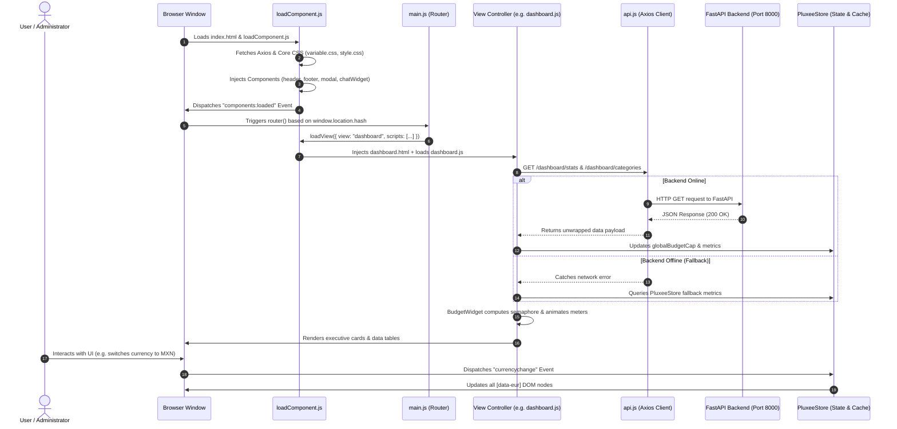

# Pluxee Enterprise HR Suite - Frontend Application


---

[](https://github.com/pluxee-enterprise/pluxee-frontend)
[](https://developer.mozilla.org/en-US/docs/Web/JavaScript)
[](https://tailwindcss.com/)
[](./recursos/DESIGN.md)
[](https://www.w3.org/WAI/standards-guidelines/wcag/)
[](#)

Welcome to the official frontend technical documentation for **Pluxee Enterprise HR Suite**, a high-performance, accessible, enterprise-grade Single-Page Application (SPA) engineered for corporate benefit allocation, flexible employee compensation, and financial expense audit workflows.

---

## Table of Contents

1. [Overview & Vision](#1-overview--vision)
2. [Technology Stack & Design System](#2-technology-stack--design-system)
   - [Zero-Bundler Vanilla Architecture](#zero-bundler-vanilla-architecture)
   - [Design System: Executive Precision](#design-system-executive-precision)
   - [Iconography & Typography](#iconography--typography)
   - [Dynamic Component Injection Engine](#dynamic-component-injection-engine)
   - [Accessible HTML5 Modal Engine](#accessible-html5-modal-engine)
   - [Live Multi-Currency Engine](#live-multi-currency-engine)
3. [Architecture & Directory Structure](#3-architecture--directory-structure)
   - [Directory Tree](#directory-tree)
   - [Module Breakdown & Responsibilities](#module-breakdown--responsibilities)
   - [Application Lifecycle & Data Flow](#application-lifecycle--data-flow)
4. [Core Features & User Journeys](#4-core-features--user-journeys)
   - [Executive Dashboard](#executive-dashboard)
   - [Employee Directory & Flexible Benefits](#employee-directory--flexible-benefits)
   - [Expenses & Approvals Management](#expenses--approvals-management)
   - [Benefits & Categories Catalog](#benefits--categories-catalog)
   - [AI Assistant & GenAI Widget](#ai-assistant--genai-widget)
5. [Setup & Local Development](#5-setup--local-development)
   - [Prerequisites](#prerequisites)
   - [Option A: Unified Full-Stack Runner (Recommended)](#option-a-unified-full-stack-runner-recommended)
   - [Option B: VS Code Live Server](#option-b-vs-code-live-server)
   - [Option C: Python HTTP Server](#option-c-python-http-server)
   - [Backend API Connection Configuration](#backend-api-connection-configuration)
   - [CORS & Network Requirements](#cors--network-requirements)
6. [Design Guidelines & Coding Conventions](#6-design-guidelines--coding-conventions)
   - [Semantic HTML5 & ARIA Compliance](#semantic-html5--aria-compliance)
   - [Focus Management & Dialog Accessibility](#focus-management--dialog-accessibility)
   - [Responsive Layouts & Breakpoints](#responsive-layouts--breakpoints)
   - [State Management & Data Integrity](#state-management--data-integrity)

---

## 1. Overview & Vision

**Pluxee Enterprise HR Suite (Version 1.0.0)** is designed to streamline corporate compensation and human resource management for medium-to-large organizations. The application delivers an instant-load, zero-overhead user interface that empowers HR administrators and finance officers to:

- **Govern Benefit Budgets**: Allocate, rebalance, and monitor flexible compensation budgets across key verticals (Food & Meals, Transportation, Education & Training, Health & Well-being, and Nursery).
- **Enforce Transactional Limits**: Prevent employee overspending in real time through strict transactional checks before expenses can be recorded.
- **Audit Expense Submissions**: Review expense vouchers, preview digital receipts (PDF / Images), and approve or reject claims with documented audit justifications.
- **Surface Actionable Financial Intelligence**: Provide executive visibility via visual KPI cards, three-tier traffic light semaphores, real-time spending progress bars, and proactive GenAI-powered budgetary insights.

### Core Architectural Values

| Value | Technical Implementation | Benefit |
| :--- | :--- | :--- |
| **Zero Bundler Overhead** | Native ES6+ JavaScript modules without Vite, Webpack, or Babel. | Eliminates build pipelines, delivers instant hot reloads, and simplifies debugging in any modern browser. |
| **Instant Perceived Speed** | Dynamic view and component injection on demand via `fetch()` and asynchronous DOM insertion. | Sub-second First Contentful Paint (FCP) and smooth SPA navigation via hash routing. |
| **Strict Enterprise A11y** | Semantic HTML5 elements (`<dialog>`, `<main>`, `<nav>`, `<header>`), full ARIA attribute sets, and keyboard focus trap management. | Full compliance with WCAG 2.1 AA accessibility standards. |
| **Resilient Offline Fallback** | Hybrid data layer querying FastAPI backend services when online, with graceful fallback to `localStorage` (`PluxeeStore`). | Uninterrupted local demonstrations, automated failover, and high operational reliability. |

---

## 2. Technology Stack & Design System

### Zero-Bundler Vanilla Architecture

The frontend application adopts a modular Vanilla JavaScript architecture using standard ES6+ features. External dependencies are loaded via high-speed CDNs:

- **Runtime**: Vanilla ECMAScript 2022 (ES6+) with IIFE module encapsulation.
- **HTTP Client**: [Axios](https://axios-http.com/) (loaded via jsDelivr CDN) with centralized interceptors, timeout handling, and uniform error normalization.
- **Utility CSS**: [Tailwind CSS v3](https://tailwindcss.com/) (loaded via CDN with forms and container queries plugins).
- **Custom CSS Engine**: Modular scoped stylesheets defining design tokens, custom utility classes, and view-specific animations.

### Design System: Executive Precision

The visual identity is anchored on the **Executive Precision** design tokens (defined in `recursos/DESIGN.md` and compiled in `src/css/variable.css`):

```css
:root {
  /* Brand Primary Palette (Pluxee Navy & Dark Slate) */
  --pluxee-primary: #091426;
  --pluxee-primary-hover: #1e293b;
  --pluxee-primary-light: #213145;
  --pluxee-on-primary: #ffffff;

  /* Brand Secondary Palette (Enterprise Blue) */
  --pluxee-secondary: #0058be;
  --pluxee-secondary-hover: #2170e4;
  --pluxee-secondary-light: #eff6ff;

  /* Surfaces & Canvas */
  --pluxee-bg: #f8f9ff;
  --pluxee-surface: #ffffff;
  --pluxee-surface-container: #e5eeff;
  --pluxee-border: #e2e8f0;

  /* Status Colors */
  --pluxee-success: #059669; /* Optimal spending / Approved status */
  --pluxee-warning: #d97706; /* Warning threshold / Pending audit */
  --pluxee-error:   #dc2626; /* Critical overspend / Rejected claim */
  --pluxee-info:    #0284c7; /* Informational KPI */
}
```

### Iconography & Typography

- **Headlines & Display**: [Plus Jakarta Sans](https://fonts.google.com/specimen/Plus+Jakarta+Sans) (Weights: 600, 700, 800) for high-impact metric counters, headers, and modal titles.
- **Body & Data Tables**: [Inter](https://fonts.google.com/specimen/Inter) (Weights: 400, 500, 600) for dense financial tables, form fields, and administrative labels.
- **Iconography**: [Google Material Symbols Outlined](https://fonts.google.com/icons) utilizing standard font ligatures (`dashboard`, `payments`, `receipt_long`, `check_circle`, `cancel`, `auto_awesome`).

### Dynamic Component Injection Engine

Rather than relying on client-side routing frameworks, the application features an asynchronous micro-loader (`src/js/services/loadComponent.js`) that:
1. Dynamically loads external dependencies (Axios) and core styles (`variable.css`, `style.css`).
2. Discovers elements decorated with `data-component="<name>"` (e.g. `header`, `footer`, `modal`, `chatWidget`).
3. Fetches the associated HTML fragment (`src/html/components/<name>.html`), injects its scoped stylesheet (`src/css/<name>.css`), and loads its controller script (`src/js/components/<name>.js`).
4. Dispatches the global `components:loaded` event to initialize core routers and store singletons.

```
index.html
  │
  └─── loadComponent.js
         ├── 1. Load Axios & Core Styles (variable.css, style.css)
         ├── 2. Scan [data-component] DOM nodes
         │      ├── Injects header.html + header.css + header.js
         │      ├── Injects footer.html + footer.css + footer.js
         │      ├── Injects modal.html  + modal.css  + modal.js
         │      └── Injects chatWidget.html + chatWidget.css + chatWidget.js
         ├── 3. Load Core Services (api.js, store.js, services.js, main.js, currency.js)
         └── 4. Fire 'components:loaded' event -> router() Mounts Initial View
```

### Accessible HTML5 Modal Engine

All dialog interactions (employee creation, benefit allocation, new expense registration, category modification, and rejection reasons) are powered by the native HTML5 `<dialog>` API located in `src/html/components/modal.html` and managed by `src/js/components/modal.js`:
- **Keyboard Navigation**: Pressing `Escape` cancels and cleanly closes the dialog; focus returns to the triggering button.
- **Backdrop Dismissal**: Clicking outside the dialog bounding box closes the modal safely.
- **Form Validation**: Real-time evaluation of inputs with automatic removal of `.is-invalid` states on input correction, and clear summary banners (`.modal-form-alert`).

### Live Multi-Currency Engine

`src/js/services/currency.js` powers instant cross-currency display between Euros (**EUR / €**) and Mexican Pesos (**MXN / $**):
- **Live FX Conversion**: Automatically polls the Frankfurter foreign exchange API (`https://api.frankfurter.dev/v2/rate/eur/mxn`).
- **Local Storage Cache**: Caches daily exchange rates in `localStorage` (`eurMxnRate`) to minimize external network requests.
- **Reactive UI Update**: Switching currency via the header buttons dispatches `currencychange` and immediately updates all DOM nodes bearing the `[data-eur]` attribute.

---

## 3. Architecture & Directory Structure

### Directory Tree

```text
pluxee-frontend/
├── index.html                     # SPA Entry Point & HTML5 Shell
├── README.md                      # Production Technical Documentation
├── recursos/
│   └── DESIGN.md                  # Executive Precision Design System Tokens
└── src/
    ├── assets/                    # Brand Identity Assets & Icons
    │   ├── plexus-icon.png        # Alternate Brand Symbol
    │   ├── pluxee-icon.png        # Pluxee Logo Primary
    │   ├── pluxee-icon-tight.png  # Compact Pluxee Badge
    │   └── pluxee-symbol.png      # High-Resolution Favicon & Symbol
    │
    ├── css/                       # Modular Scoped Stylesheets
    │   ├── variable.css           # Global Design Tokens & Color Palettes
    │   ├── style.css              # Reset, Base Styles & Shared Utilities
    │   ├── header.css             # Navigation Header & Mobile Menu Styles
    │   ├── footer.css             # Global Application Footer
    │   ├── modal.css              # Native <dialog> Modal Styles & Transitions
    │   ├── dashboard.css          # Executive Dashboard & Semaphore Meter
    │   ├── employees.css          # Employee Directory & Pagination Styles
    │   ├── expenses.css           # Expense Audit Table, KPIs & Vouchers
    │   ├── categories.css         # Bento Grid Category Catalog & Semaphores
    │   ├── chatWidget.css         # GenAI Floating Assistant Drawer
    │   └── demo.css               # Interactive Component Playground Styles
    │
    ├── html/                      # Modular HTML Templates
    │   ├── components/            # Reusable Interface Fragments
    │   │   ├── header.html        # Sticky Navigation Bar & Currency Selector
    │   │   ├── footer.html        # Copyright & Versioning Footer
    │   │   ├── modal.html         # Native Accessible Modal Dialog
    │   │   ├── modal-empleado.html# Employee Form Template
    │   │   ├── modal-gasto.html   # Expense Claim Form Template
    │   │   ├── modal-ticket.html  # Receipt Voucher Preview Template
    │   │   └── chatWidget.html    # GenAI Chat Drawer Widget
    │   │
    │   ├── views/                 # Top-Level SPA Route Views
    │   │   ├── dashboard.html     # Executive Dashboard & Financial KPIs
    │   │   ├── employees.html     # Employee Directory & Benefits Management
    │   │   ├── expenses.html      # Expense Audit & Approval Workflows
    │   │   ├── categories.html    # Benefit Categories Catalog & Budget Caps
    │   │   └── demo.html          # Dynamic Modal Demonstration View
    │   │
    │   └── pages/                 # Standalone Multi-Page HTML Fallbacks
    │       ├── empleados.html
    │       ├── gastos.html
    │       └── detalle-empleado.html
    │
    └── js/                        # Modular JavaScript Architecture
        ├── main.js                # SPA Hash Router & App Initialization
        │
        ├── components/            # Component Controllers
        │   ├── header.js          # Hamburger Menu & Navigation Focus Logic
        │   ├── footer.js          # Dynamic Copyright Year Formatter
        │   ├── modal.js           # Modal Lifecycle, Trap Focus & Validation
        │   ├── budgetWidget.js    # 3-Tier Budget Traffic Light Semaphore Engine
        │   ├── chatWidget.js      # GenAI Floating Chatbot Controller
        │   └── notifications.js   # Toast Notification System Hooks
        │
        ├── services/              # HTTP Services & Data Clients
        │   ├── api.js             # Centralized Axios Client & Error Enricher
        │   ├── services.js        # High-Level Domain Service Abstraction
        │   ├── employeeService.js # Employee CRUD & Pagination Orchestrator
        │   ├── expenseService.js  # Expense Submission & Approval API Client
        │   ├── categoryService.js # Dynamic Category Engine & Icon Matcher
        │   ├── currency.js        # Multi-Currency Conversion & DOM Formatter
        │   ├── genkitService.js   # GenAI Financial Diagnosis Service
        │   └── loadComponent.js   # Dynamic Component & View Injector
        │
        ├── state/                 # Reactive State Management
        │   └── store.js           # Central Store, Transaction Engine & Sync
        │
        ├── utils/                 # Utility Libraries
        │   ├── currency.js        # Currency Formatting Helpers
        │   ├── formatters.js      # String & Number Formatters
        │   └── validators.js      # Form Validation Primitives
        │
        └── views/                 # View Orchestrators
            ├── dashboard.js       # Live Dashboard Controller & Backend Sync
            ├── expenses.js        # Expense Audit Table, KPIs & Filters
            └── demo.js            # Interactive Modal Demo Controller
```

### Module Breakdown & Responsibilities

| Module | Location | Primary Responsibility |
| :--- | :--- | :--- |
| **`loadComponent.js`** | `src/js/services/` | Bootstraps the application, injects styles, loads external vendor scripts, and mounts components dynamically. |
| **`main.js`** | `src/js/` | Defines the SPA route table (`ROUTES`), listens for `hashchange` events, and coordinates view mounting. |
| **`api.js`** | `src/js/services/` | Instantiates Axios configured for `http://localhost:8000/api/v1`. Intercepts errors and enriches FastAPI/Pydantic 422 arrays into human-readable messages. |
| **`store.js`** | `src/js/state/` | Singleton store (`PluxeeStore`) maintaining state in `localStorage` (`pluxee_store_v2`), providing cross-tab synchronization and balance calculations. |
| **`budgetWidget.js`** | `src/js/components/` | Evaluates spending ratios and computes traffic-light tiers (`green` <=33%, `amber` 33-66%, `red` >66%). Smoothly animates progress bars. |
| **`categoryService.js`** | `src/js/services/` | Manages category CRUD operations and features `ICON_ALIAS_MAP` for resilient Google Material Symbols ligature resolution. |
| **`currency.js`** | `src/js/services/` | Fetches exchange rates from Frankfurter API and reactively reformats monetary values across the DOM. |
| **`genkitService.js`** | `src/js/services/` | Queries Google Genkit AI backend endpoints (`/ai/insights`) to produce structured executive financial health reports. |

### Application Lifecycle & Data Flow



---

## 4. Core Features & User Journeys

### Executive Dashboard
*Path: `#dashboard` | Files: `dashboard.html`, `dashboard.css`, `dashboard.js`, `budgetWidget.js`*

The executive command center delivers instantaneous insight into the organization's flexible benefit spending:
- **3 High-Impact KPI Cards**:
  1. **Total Asignado** (*Global Budget*): Displays total allocated funds with a quick-edit dialog to update corporate spending caps via `PUT /company/budget`.
  2. **Total Gastado** (*Budget Monitor & Semaphore*): Displays total consumed funds with an animated progress bar and a dynamic status indicator:
     - 🟢 **Nivel Óptimo (Green)**: $\le 33\%$ consumed. Healthy budget margin.
     - 🟡 **Tope Próximo (Amber)**: $33\% < \text{ratio} \le 66\%$. Warning threshold; spending is approaching limits.
     - 🔴 **Alerta Crítica (Red)**: $> 66\%$ consumed. Overspend risk; immediate supervisory audit advised.
  3. **Saldo Disponible Restante**: Real-time remaining balance available for employee claim fulfillment.
- **Budget Consumed Dynamic Label**: Outputs standard descriptive text (e.g., `Budget Consumed: €28.500 of €45.000 (63.3%)`).
- **Category Distribution Grid**: Bento cards displaying budget caps, spent amounts, and completion meters for all active verticals.
- **Recent Active Employees Table**: Displays recent employee benefit usage with category badges and quota status indicators.

---

### Employee Directory & Flexible Benefits
*Path: `#empleados` | Files: `employees.html`, `employees.css`, `employeeService.js`*

Comprehensive employee catalog and flexible benefit assignment interface:
- **10-per-Page Client-Side Pagination**: Clean pagination control featuring unified **1..5 numerical page buttons** with active styling (`is-current`) and Previous/Next buttons.
- **Department & Search Filtering**: Instant filtering by department (Technology, Marketing, HR, Sales) and fuzzy text search across employee names and emails.
- **Strict Benefit Allocation Rule**: Enforces the business constraint that **an employee may have at most one active benefit per category**. Existing benefits are updated in place rather than duplicated.
- **Employee Creation & Budget Caps**: Accessible modal dialog to register new employees and establish individual ceiling caps. Validates that allocated employee sums do not exceed the company's remaining unassigned budget.

---

### Expenses & Approvals Management
*Path: `#expenses` | Files: `expenses.html`, `expenses.css`, `expenseService.js`, `views/expenses.js`*

Full audit cycle for employee expense vouchers and reimbursement claims:
- **Visual KPI Summary Cards**:
  - **Total Tramitado**: Total expense count and gross financial amount.
  - **Pendientes de Visado**: Total claims waiting for HR audit review (amber badge).
  - **Gastos Aprobados**: Successfully audited claims (green badge, formatted in euros/pesos).
  - **Gastos Rechazados**: Denied claims (rose/red badge with rejection justification).
- **Interactive Status Filter Tabs**: Quick filtering by status:
  - `Todos` (All claims)
  - `Pendientes` (Pending review)
  - `Aprobados` (Approved claims)
  - `Rechazados` (Rejected claims)
- **Unified 6-per-Page Pagination**: Synchronized 1..5 page buttons matching the design system of the Employee Directory.
- **Digital Receipt Preview**: Detects voucher file extensions (`.pdf` vs `.png`/`.jpg`) and displays appropriate Google Material Symbols ligatures (`picture_as_pdf` or `image`) linking directly to uploaded attachments.
- **Approval & Rejection Workflows**: One-click approval via `PATCH /expenses/{id}/approve` and rejection with mandatory reason input via `PATCH /expenses/{id}/reject`.
- **Transactional Expense Registration**: Form modal with live balance check preventing submission if the requested amount exceeds the employee's category balance.

---

### Benefits & Categories Catalog
*Path: `#categorias` | Files: `categories.html`, `categories.css`, `categoryService.js`*

Administrative catalog enabling HR leadership to define corporate benefit offerings:
- **Dynamic Category Configuration**: Create and edit categories, define individual budget ceilings, and select thematic colors.
- **Resilient Icon Matching (`ICON_ALIAS_MAP`)**: Normalizes icons and accommodates legacy names or synonyms to guarantee that valid Google Material Symbols ligatures are always rendered:
  ```javascript
  const ICON_ALIAS_MAP = {
    utensils: "restaurant",
    bus: "directions_bus",
    "book-open": "school",
    "heart-pulse": "health_and_safety",
    baby: "child_care",
    dumbbell: "fitness_center"
  };
  ```
- **Live Category Semaphore**: Visual progress track indicating the proportion of the category's assigned budget that has been consumed.

---

### AI Assistant & GenAI Widget
*Components: `chatWidget.html`, `chatWidget.css`, `chatWidget.js`, `genkitService.js`*

Integrated artificial intelligence tools powered by Google Genkit and Gemini models:
- **Pluxee AI Advisor (Dashboard)**: Generates a 3-part structured diagnostic report:
  1. *Global Budget Health*: Macro financial solvency overview.
  2. *Limit Alerts*: Flags departments or employees consuming $>66\%$ of their assigned cap.
  3. *Optimization Recommendations*: Strategic advice on budget rebalancing.
  - Features an animated shimmering skeleton loading state (`#ai-skeleton-loader`) during generation.
- **Floating Chat Assistant**: Accessible via the bottom-right floating toggle button (`💬`).
  - Queries `POST http://127.0.0.1:8000/chat` with complete conversation history.
  - Renders markdown formatting and parses embedded JSON data into styled HTML tables.
  - Automatically renders **Download PDF Report** links (`chat-pdf-link`) when the assistant generates printable reports.

---

## 5. Setup & Local Development

### Prerequisites

- A modern web browser supporting ES6+, HTML5 `<dialog>`, and CSS Container Queries (Google Chrome 105+, Microsoft Edge 105+, Mozilla Firefox 111+, or Apple Safari 16.4+).
- Python 3.10+ (for local serving or backend orchestration).
- FastAPI backend running at `http://127.0.0.1:8000` (optional for offline mock mode, required for live features).

---

### Option A: Unified Full-Stack Runner (Recommended)

The easiest way to run the entire Pluxee platform (both FastAPI backend and Vanilla JS frontend) simultaneously is using the root dev runner located in `pluxee-backend`:

```powershell
# From the project root or pluxee-backend directory:
cd a:\TRABAJO-SINCRONIZADO\Clases\05-Proyecto-Graduacion\pluxee-backend

# Launch both servers with automatic browser opening:
python start_dev.py
```

`start_dev.py` automatically:
1. Detects Python virtual environments.
2. Starts FastAPI backend on `http://127.0.0.1:8000` via Uvicorn.
3. Starts Python's HTTP static server on `http://127.0.0.1:5500` serving `pluxee-frontend`.
4. Opens `http://127.0.0.1:5500` in your default browser.

---

### Option B: VS Code Live Server

If you use the popular **Live Server** extension (by Ritwick Dey) in Visual Studio Code:

1. Open `pluxee-frontend` in VS Code.
2. Right-click `index.html` and select **"Open with Live Server"**.
3. Live Server will serve the application on:
   ```text
   http://127.0.0.1:5500/index.html
   ```

---

### Option C: Python HTTP Server

To serve the frontend standalone using Python's built-in web server:

```powershell
# Navigate to the frontend directory:
cd a:\TRABAJO-SINCRONIZADO\Clases\05-Proyecto-Graduacion\pluxee-frontend

# Start HTTP server on port 5500:
python -m http.server 5500
```

Then navigate to `http://localhost:5500` in your browser.

---

### Backend API Connection Configuration

The frontend connects to the backend through `src/js/services/api.js`. The default target is:

```javascript
const API_BASE_URL = window.API_BASE_URL || 'http://localhost:8000/api/v1';
```

To redirect the frontend to a remote or staged backend without modifying source code, set `window.API_BASE_URL` in `index.html` before `loadComponent.js` is loaded:

```html
<script>
  window.API_BASE_URL = 'https://api.staging.pluxee.enterprise.io/api/v1';
</script>
<script src="/src/js/services/loadComponent.js"></script>
```

### CORS & Network Requirements

The FastAPI backend must configure `CORSMiddleware` to permit local development origins:

```python
# fastapi backend configuration
origins = [
    "http://localhost:5500",
    "http://127.0.0.1:5500",
    "http://localhost:3000",
]
```

---

## 6. Design Guidelines & Coding Conventions

### Semantic HTML5 & ARIA Compliance

All views and components must strictly adhere to semantic HTML standards:
- **Landmarks**: Ensure pages use `<header>`, `<main id="app">`, `<nav>`, `<section>`, and `<footer>`.
- **Tables**: Wrap tables in responsive containers (`pluxee-table-responsive`), use explicit `<thead>` and `<tbody>`, and apply numeric alignment classes (`text-right`, `is-right`, `is-center`).
- **Interactive Controls**: Use `<button type="button">` for UI actions (never unadorned `<a>` or `<div>`).
- **ARIA States**: Keep ARIA attributes synchronized with JavaScript states:
  - Navigation tabs: `aria-pressed="true|false"`
  - Pagination buttons: `aria-current="page"`
  - Dynamic loaders: `aria-busy="true"` and `aria-live="polite"`
  - Metric meters: `role="progressbar"` with `aria-valuenow`, `aria-valuemin`, and `aria-valuemax`

### Focus Management & Dialog Accessibility

When opening modals via `window.openDynamicModal()`:
1. Focus is trapped inside the `<dialog id="app-modal">` element.
2. If invalid fields exist on submit, focus automatically moves to the first invalid control (`.is-invalid`).
3. Upon modal closure, focus is returned to the element that triggered the dialog.

### Responsive Layouts & Breakpoints

The application implements a responsive design supporting both desktop monitors and mobile devices:
- **Mobile Navigation**: When the viewport is below `1100px`, the header collapses into an accessible mobile hamburger drawer controlled by `src/js/components/header.js`.
- **Card Grids**: Bento grids scale gracefully from 1 column on mobile screens to 3 columns on desktop displays (`grid-cols-1 md:grid-cols-2 lg:grid-cols-3`).
- **Horizontal Scroll Concealment**: Dense financial tables feature horizontal scrolling while standard browser scrollbars are hidden using CSS rules in `style.css` for a native application feel.

### State Management & Data Integrity

- **Never bypass `PluxeeStore`**: When operating in mock or fallback mode, all state modifications (adding employees, updating budget caps, approving expenses) must execute through `PluxeeStore` methods to maintain transactional balance integrity and notify subscribers.
- **Defensive String & Number Handling**: All user-supplied strings must be sanitized using `escapeHTML()` before interpolation into `innerHTML`. Numerical values must be validated with `Number.isFinite()` prior to formatting.

---

## Contributors & Project Metadata

- **Project**: Pluxee Enterprise HR Suite (Graduation Project / Proyecto de Graduación)
- **Frontend Version**: 1.0.0
- **Authors**: Pluxee Frontend Engineering & Architecture Team
- **Document Version**: 1.0.0 (October 2026)
